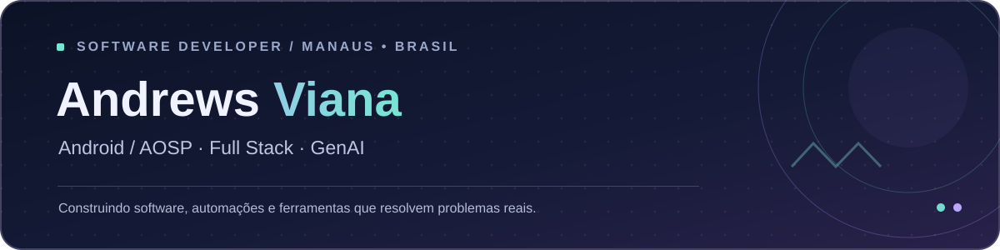

 

**Estagiário de Desenvolvimento Android/AOSP na Positivo Tecnologia** · **Engenharia de Software — UNINTER**

`📍 Manaus, AM` &nbsp; `🌐 Inglês intermediário` &nbsp; `🔧 Android • APIs • Automação`

---

### 👨‍💻 Sobre mim

Desenvolvo e customizo sistemas **Android/AOSP**, trabalhando com builds, pacotes **OTA/FOTA**, investigação de falhas, testes e automação com scripts. Fora do trabalho, construo aplicações full stack e ferramentas de **IA aplicada à engenharia de software**.

Gosto de transformar problemas técnicos em soluções utilizáveis — da análise do requisito à API, interface e implantação.

### 🛠️ Tech stack & ferramentas

**Android, engenharia e desenvolvimento**

**Full stack e dados**

**Infraestrutura & ferramentas**

**IA generativa:** `Gemini` · `Ollama` · `Qwen` · `Prompt Engineering` · `Integração de LLMs`

Competências adquiridas no trabalho, em projetos independentes e em estudos; Spring Boot está entre os conhecimentos em desenvolvimento.

### 📊 Meu dashboard no GitHub

 

Os cards são gerados por serviços externos e podem sofrer limites de acesso. As linguagens refletem os repositórios públicos, não o nível de domínio técnico nem o trabalho em repositórios privados.

### 🚀 Projetos em destaque

<table>
<tr>
<td width="50%" valign="top">
<h3>🔧 PROCAR — Gestão de oficinas</h3>

Sistema full stack desenvolvido para uma oficina real: clientes, veículos, orçamentos, ordens de serviço, inspeções, pagamentos e estoque.

<code>Angular</code> <code>Django REST</code> <code>PostgreSQL</code> <code>Docker</code>

<a href="https://procar-portfolio-demo.vercel.app/"><strong>▶ Testar demonstração</strong></a> · <a href="https://andrews-viana-portfolio.vercel.app/case/procar">Estudo de caso</a>

</td>
<td width="50%" valign="top">
<h3>🤖 FOTA AI Agent</h3>

Ferramenta de apoio à leitura de commits e diffs, organização de mudanças, riscos, impacto e checklist para QA.

<code>Python</code> <code>Django</code> <code>LLMs</code> <code>Git</code>

<a href="https://fota-engineering-suite-demo.vercel.app/fota-ai-agent/"><strong>▶ Testar demonstração</strong></a> · <a href="https://andrews-viana-portfolio.vercel.app/case/fota-ai-agent">Estudo de caso</a>

</td>
</tr>
<tr>
<td width="50%" valign="top">
<h3>🔍 FOTA Log Analyzer</h3>

Análise técnica de logs de atualização OTA/FOTA, com evidências e hipóteses para investigação de falhas.

<code>Python</code> <code>Django</code> <code>Logs</code> <code>Debugging</code>

<a href="https://fota-engineering-suite-demo.vercel.app/fota-log-analyzer/"><strong>▶ Testar demonstração</strong></a> · <a href="https://andrews-viana-portfolio.vercel.app/case/fota-log-analyzer">Estudo de caso</a>

</td>
<td width="50%" valign="top">
<h3>✨ GenAI Engineering Studio</h3>

Laboratório independente com interface Angular para experimentar análise de commits e logs com entradas sintéticas.

<code>Angular</code> <code>TypeScript</code> <code>IA aplicada</code>

<a href="https://andrews-viana-portfolio.vercel.app/workspace"><strong>▶ Abrir laboratório</strong></a> · <a href="https://andrews-viana-portfolio.vercel.app/">Portfólio</a>

</td>
</tr>
</table>

> **Sobre os projetos:** o PROCAR público utiliza banco separado, dados fictícios e acesso somente leitura. Os exemplos públicos dos agentes FOTA são versões independentes de demonstração, sem código, logs ou infraestrutura internos.

### 🎓 Formação

- **Bacharelado em Engenharia de Software** — UNINTER *(em andamento)*
- **Técnico em Desenvolvimento de Software** — concluído
- **Técnico em Informática, ênfase em programação** — concluído

---

**Vamos construir algo interessante?**

Desenvolvido com dedicação em Manaus, Amazonas 🇧🇷

